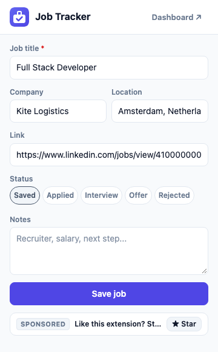
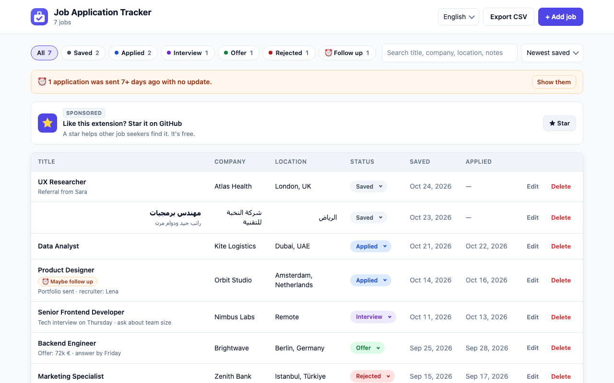

<div dir="rtl">

[English](README.md) | **العربية**

<p align="center">
  
</p>

<h1 align="center">متتبع طلبات التوظيف</h1>

<p align="center">
  احفظ الوظائف من LinkedIn وIndeed وأي موقع توظيف بنقرة واحدة، وتابع كل طلباتك في لوحة واحدة خاصة بك.
</p>

<p align="center">
  
  <a href="LICENSE"></a>
  
  
  <a href="https://github.com/omar-diab/job-application-tracker/actions/workflows/check.yml"></a>
</p>

<p align="center">
  
</p>

## لماذا هذه الإضافة؟

عندما تبحث عن عمل، تتقدّم إلى أماكن كثيرة. وبعد فترة قصيرة يصبح عندك جدول فيه 50 صفًا، وروابط منسوخة، وحالات غير صحيحة، ولا تعرف لمن يجب أن تُرسل متابعة.

هذه الإضافة تقوم بالعمل المُمل بدلًا منك. افتح إعلان الوظيفة، واضغط على الأيقونة، فتجد المسمّى الوظيفي والشركة والموقع والرابط جاهزة. كل شيء يُحفظ في لوحة واحدة ترى فيها حالة كل طلب.

## المزايا

- 🖱️ **حفظ بنقرة واحدة**: تقرأ المسمّى الوظيفي والشركة والموقع والرابط من الصفحة.
- 🔁 **بدون تكرار**: إذا كانت الوظيفة محفوظة، تعرض النافذة حالتها وتسمح لك بتحديثها.
- 🎨 **5 حالات ملوّنة**: محفوظة، تم التقديم، مقابلة، عرض، مرفوضة.
- 📋 **لوحة تحكم**: تصفية حسب الحالة (مع العدد)، بحث، ترتيب، تعديل، حذف، وإضافة وظيفة يدويًا.
- ⏰ **تذكير بالمتابعة** عندما يمرّ 7 أيام أو أكثر على طلب بحالة «تم التقديم».
- 📤 **تصدير CSV** يُفتح بشكل صحيح في Excel، مع النص العربي.
- 🌙 **وضع فاتح وداكن** حسب إعدادات جهازك.
- 🌍 **دعم العربية والكتابة من اليمين لليسار** في كل الحقول.
- 🔒 **محلي 100%**: بدون حساب، بدون خادم، بدون تتبع. بيانات وظائفك لا تغادر جهازك.
- ⭐ **اشتراك Premium اختياري** لدعم المشروع (مزايا الذكاء الاصطناعي قريبًا). كل المزايا السابقة تبقى مجانية.

## صور الشاشة

| النافذة المنبثقة | لوحة التحكم | لوحة التحكم (داكن) |
| :---: | :---: | :---: |
|  |  |  |

## المواقع المدعومة

| الموقع | طريقة قراءة الوظيفة |
| --- | --- |
| **LinkedIn** | عناصر صفحة الوظيفة (المسمّى، الشركة، الموقع) |
| **Indeed** (كل الدول، مثل `ae.indeed.com` و`indeed.co.uk`) | عناصر صفحة الوظيفة |
| **أي موقع توظيف فيه [JobPosting JSON-LD](https://schema.org/JobPosting)** (مواقع شركات كثيرة، Greenhouse، Lever، Workday، ...) | البيانات المنظّمة التي تنشرها المواقع لـ Google |
| **أي صفحة أخرى** | عنوان الصفحة، حتى تستطيع حفظها وتصحيح الحقول |

موقع لا يُقرأ بشكل صحيح؟ [افتح بلاغ «Site not working»](https://github.com/omar-diab/job-application-tracker/issues/new/choose).

## الخصوصية

بيانات وظائفك لا تغادر جهازك أبدًا.

- تُحفظ الوظائف فقط في `chrome.storage.local` داخل متصفحك، ولا تُرسل إلى أي مكان.
- لا حساب، لا إحصاءات، لا تتبع، لا إعلانات.
- تُقرأ الصفحة **فقط عندما تضغط على الأيقونة**.

تطلب الإضافة 3 صلاحيات فقط:

| الصلاحية | السبب |
| --- | --- |
| `storage` | حفظ وظائفك على جهازك. |
| `activeTab` | قراءة التبويب الذي أنت فيه، فقط بعد الضغط على الأيقونة. لا وصول إلى «كل المواقع». |
| `scripting` | تشغيل قارئ الصفحة الصغير في ذلك التبويب لإيجاد تفاصيل الوظيفة. |

### اشتراك Premium والدفع

- تتم عمليات الدفع عبر **[Dodo Payments](https://dodopayments.com)** (التاجر المسجّل). **لا نرى بيانات بطاقتك أبدًا.**
- بعد الدفع، ترسل Dodo إليك **مفتاح ترخيص** بالبريد الإلكتروني، فتلصقه في نافذة Premium.
- تتصل الإضافة بـ Dodo فقط للتحقق من مفتاح الترخيص: عند إدخاله، ومرة واحدة كل 12 ساعة على الأكثر. وظائفك وملاحظاتك لا تُرسل أبدًا.

اقرأ [سياسة الخصوصية](PRIVACY.md) كاملة.

## التثبيت من سوق Chrome الإلكتروني

قريبًا: [متتبع طلبات التوظيف في سوق Chrome الإلكتروني](https://chromewebstore.google.com/detail/REPLACE_WITH_EXTENSION_ID)

## التثبيت للمطوّرين

1. نزّل المستودع: **Code ← Download ZIP** (ثم فُكّ الضغط)، أو:

<div dir="ltr">

```bash
git clone https://github.com/omar-diab/job-application-tracker.git
```

</div>

2. افتح `chrome://extensions` في Chrome.
3. فعّل **Developer mode** (وضع المطوّر) في الأعلى.
4. اضغط **Load unpacked** واختر مجلد المشروع (المجلد الذي فيه `manifest.json`).
5. ثبّت الإضافة في الشريط: اضغط أيقونة قطعة الأحجية 🧩 ثم الدبوس 📌.

لا توجد خطوة بناء ولا `npm install`. الكود يعمل كما هو.

## طريقة الاستخدام

1. افتح إعلان وظيفة (LinkedIn أو Indeed أو صفحة وظائف شركة).
2. اضغط على أيقونة الإضافة. راجع الحقول، واختر الحالة، وأضف ملاحظاتك.
3. اضغط **Save job**.
4. اضغط **Dashboard ↗** لترى كل وظائفك. يمكنك تغيير الحالة مباشرة من القائمة.
5. اضغط **Export CSV** لفتح قائمتك في Excel أو Google Sheets.

## بنية المشروع

<div dir="ltr">

```
job-application-tracker/
├── manifest.json            Extension settings and the 3 permissions
├── _locales/                Translations (one messages.json per language)
├── icons/                   Extension icons (16, 48, 128 px)
├── shared/
│   ├── base.css             Shared design: colors, dark mode, status colors, fields, buttons
│   ├── i18n.js              Translations: t(), language picker, right-to-left
│   ├── core.js              Statuses, safe h() element helper, dates, links, jobs, storage
│   ├── extractor.js         Reads the job from a page (LinkedIn, Indeed, JSON-LD, title)
│   └── premium.js           Premium: plans, Dodo checkout, license key activation and checks
├── popup/
│   ├── popup.html           The popup window
│   ├── popup.css            Popup styles
│   └── popup.js             Reads the tab, checks duplicates, saves the job
├── dashboard/
│   ├── dashboard.html       The full-page dashboard
│   ├── dashboard.css        Dashboard styles, phone card view, dialog
│   └── dashboard.js         List, filters, search, sort, add/edit dialog, CSV export
├── tools/                   Helpers for developers (NOT part of the extension)
│   ├── make-icons.html/.js  Draws the icons and downloads them as PNG
│   ├── test-core.html/.js   Tests for shared/core.js
│   └── test-extractor.html/.js  Tests for shared/extractor.js
└── docs/screenshots/        Images for this README
```

</div>

- `shared/`: الكود المشترك بين النافذة المنبثقة ولوحة التحكم.
- `popup/`: النافذة الصغيرة التي تظهر عند الضغط على الأيقونة.
- `dashboard/`: صفحة لوحة التحكم الكاملة.
- `tools/`: أدوات للمطوّرين فقط، وليست جزءًا من الإضافة.

## كيف تعمل؟

<div dir="ltr">

```
Click icon → popup.js → chrome.scripting.executeScript(extractJobInfo) → reads the job page
          → core.js cleans the data and checks for duplicates → chrome.storage.local
          → dashboard.js listens to chrome.storage.onChanged → the list updates by itself
```

</div>

- الدالة `extractJobInfo` مستقلة تمامًا، لأن Chrome ينسخ هذه الدالة وحدها إلى الصفحة.
- كل النصوص تُضاف باستخدام `textContent` (عبر الدالة المساعدة `h()`)، وليس `innerHTML` أبدًا، فلا يمكن لعنوان وظيفة أن يحقن كود HTML.
- تُوحَّد الروابط (`/jobs/view/123/` و`?jk=...` وحذف معاملات التتبع)، فلا تُحفظ الوظيفة نفسها مرتين.
- **Premium:** يُفعَّل مفتاح الترخيص عبر واجهة التراخيص العامة في Dodo Payments (دون أي مفتاح سرّي داخل الإضافة)، وتُحفظ النتيجة في `chrome.storage.local`. تقرأ النافذة المنبثقة ولوحة التحكم هذه القيمة المحفوظة، فتفتحان بسرعة وتعملان دون إنترنت.

## تشغيل الاختبارات

لا تحتاج إلى تثبيت أي شيء. افتح هذه الملفات في Chrome:

- `tools/test-core.html`: يختبر الروابط والتواريخ والوظائف والتخزين والدالة `h()`.
- `tools/test-extractor.html`: يختبر LinkedIn وIndeed وJSON-LD والنص العربي والصفحات المعطوبة.

يجب أن تكون كل الأسطر خضراء، مع مجموع في الأعلى مثل **17 / 17 tests passed**.

ومع كل `push`، يفحص GitHub Actions أيضًا ملف `manifest.json` وصحة كود JavaScript والصلاحيات.

## خطط مستقبلية

أفكار للمستقبل، ونرحّب برأيك!

- 🗓️ مواعيد المقابلات والتذكيرات (مخطّط لها)
- 📥 الاستيراد من CSV، والنسخ الاحتياطي والاستعادة (مخطّط لها)
- 🌐 مواقع توظيف أكثر: Bayt وGlassdoor وWellfound وNaukrigulf (مخطّط لها)
- 🇸🇦 واجهة باللغة العربية (مخطّط لها)
- 🦊 نسخة لمتصفح Firefox (مخطّط لها)

## المساهمة

المساهمات مرحّب بها، وخاصة **تحديث المحدِّدات (selectors) عندما يغيّر LinkedIn أو Indeed صفحاتهما**. اقرأ [CONTRIBUTING.md](CONTRIBUTING.md) للبدء.

وجدت مشكلة أمنية؟ اقرأ [SECURITY.md](SECURITY.md) وأبلغ عنها بشكل خاص.

## الرخصة

[MIT](LICENSE) © 2026 Omar Diab

</div>
