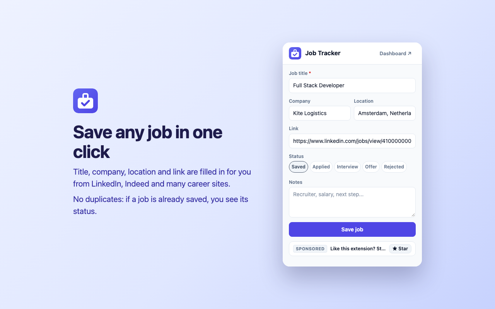
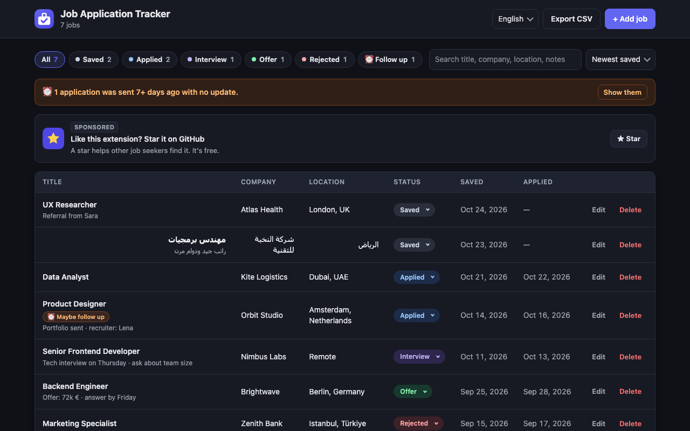
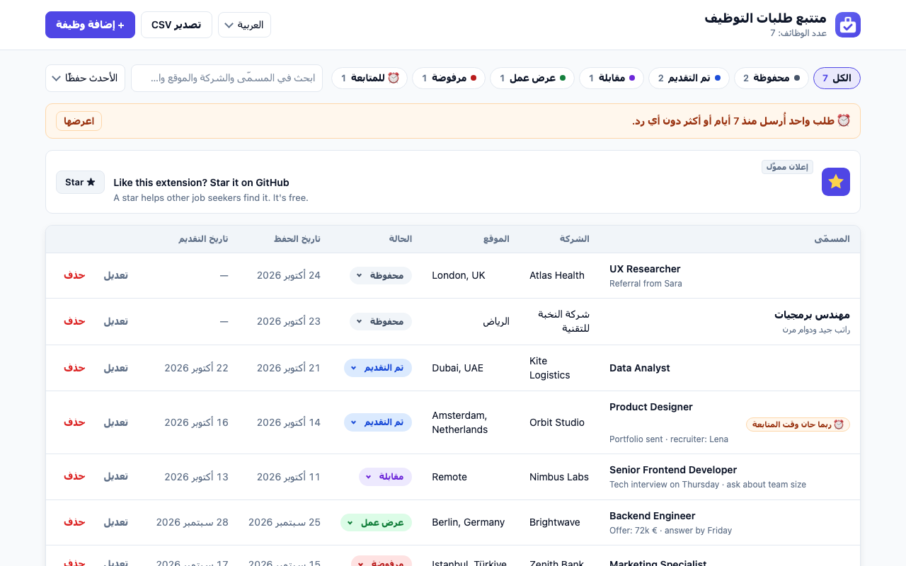

**English** | [العربية](README.ar.md)

<p align="center">
  
</p>

<h1 align="center">Job Application Tracker</h1>

<p align="center">
  <b>Save jobs from LinkedIn, Indeed and any career site in one click,<br>and track every application in one private dashboard.</b>
</p>

<p align="center">
  <a href="https://github.com/omar-diab/Job-Application-Tracker/releases/latest"></a>
  
  
  
  
  <a href="LICENSE"></a>
  <a href="https://github.com/omar-diab/Job-Application-Tracker/actions/workflows/check.yml"></a>
</p>

<p align="center">
  <a href="https://github.com/omar-diab/Job-Application-Tracker/releases/latest"><b>⬇️ Download v1.0.0</b></a> ·
  <a href="#-install">Install</a> ·
  <a href="PRIVACY.md">Privacy</a> ·
  <a href="CHANGELOG.md">Changelog</a> ·
  <a href="https://github.com/omar-diab/Job-Application-Tracker/issues/new/choose">Report a problem</a>
</p>

<p align="center">
  
</p>

> [!NOTE]
> **Version 1.0.0 — first release.** Free for everyone, 13 languages, light and dark mode, and your job data stays on your computer. The extension is now **in review on the Chrome Web Store**.

## Why this exists

When you look for a job, you apply to many places. Soon you have a spreadsheet with 50 rows, copied links, wrong statuses, and no idea who you should follow up with.

**Job Application Tracker does the boring part for you.** Open a job post, click the icon, and the title, company, location and link are already filled in. Everything goes into one clear dashboard where you can see where every application stands.

## ✨ Features

| | |
| --- | --- |
| 🖱️ **One-click save** | Reads the job title, company, location and link from the page you are on. |
| 🔁 **No duplicates** | If a job is already saved, the popup shows its status so you can update it. |
| 🎨 **5 colored statuses** | Saved, Applied, Interview, Offer, Rejected. Change them right from the list. |
| 🔍 **Filter, search, sort** | Filter by status with counts, search everything, and sort 7 ways. |
| ⏰ **Follow-up reminder** | A gentle hint when an application has been "Applied" for 7+ days with no answer. |
| 📤 **CSV export** | Opens correctly in Excel and Google Sheets, including Arabic text. |
| 🌍 **13 languages** | With a language picker, right-to-left layout for Arabic, and local date formats. |
| 🌙 **Light and dark mode** | Follows your system automatically. |
| 🔒 **Private by design** | No account, no server, no tracking. Your jobs never leave your computer. |
| 🆓 **Free** | Supported by one small, clearly labeled "Sponsored" card inside the extension. |

## 📸 Screenshots

<table>
  <tr>
    <td width="50%" align="center"><br><sub><b>Save a job in one click</b></sub></td>
    <td width="50%" align="center"><br><sub><b>Dark mode</b></sub></td>
  </tr>
  <tr>
    <td width="50%" align="center"><br><sub><b>Arabic, right to left (and 12 more languages)</b></sub></td>
    <td width="50%" align="center"><br><sub><b>The popup</b></sub></td>
  </tr>
</table>

## 🌐 Supported sites

| Site | How the job is read |
| --- | --- |
| **LinkedIn** | Title, company and location from the job page |
| **Indeed** (all countries, like `ae.indeed.com`, `indeed.co.uk`) | Title, company and location from the job page |
| **Any career site with [JobPosting data](https://schema.org/JobPosting)** (many company sites, Workday, Lever, ...) | The structured data that sites publish for Google |
| **Any other page** | The page title, so you can still save it and fix the fields |

A site doesn't read correctly? [Open a "Site not working" issue](https://github.com/omar-diab/Job-Application-Tracker/issues/new/choose).

**Languages:** English, English (UK), العربية, Deutsch, Español, Français, Bahasa Indonesia, Português (Brasil), Русский, Türkçe, हिन्दी, 简体中文, 日本語.

## 🔒 Privacy

Your job data never leaves your computer.

- Jobs are saved only in `chrome.storage.local`, inside your browser. They are never sent anywhere.
- No account, no analytics, no tracking, no ad networks.
- The page is read **only when you click the icon**.
- The extension shows **one small "Sponsored" card** inside its own popup and dashboard (never on websites). It is built into the extension and tracks nothing.

Only 3 permissions:

| Permission | Why |
| --- | --- |
| `storage` | Save your jobs on your computer. |
| `activeTab` | Read the tab you are on, only after you click the icon. No access to "all websites". |
| `scripting` | Run the small page reader in that tab to find the job details. |

Read the full [privacy policy](PRIVACY.md).

## 📦 Install

### From the Chrome Web Store

The extension is **in review**. The store link will be added here as soon as it is published.

### From the release (works today)

1. Download **`job-application-tracker-1.0.0.zip`** from the [latest release](https://github.com/omar-diab/Job-Application-Tracker/releases/latest) and unzip it.
2. Open `chrome://extensions` and turn on **Developer mode** (top right).
3. Click **Load unpacked** and choose the unzipped folder.
4. Pin it: click the puzzle icon 🧩 in the toolbar, then the pin 📌.

### For developers

```bash
git clone https://github.com/omar-diab/Job-Application-Tracker.git
```

Then load the project folder with **Load unpacked**. No build step and no `npm install`: the code runs as it is.

> The `main` branch is the development version (now **1.1.0**, with Premium in progress). For the released version, use the zip from [Releases](https://github.com/omar-diab/Job-Application-Tracker/releases).

## 🚀 How to use

1. Open a job post (LinkedIn, Indeed or a company career page).
2. Click the extension icon. Check the fields, choose a status, add notes.
3. Click **Save job**.
4. Click **Dashboard ↗** to see all your jobs. Change a status right from the list.
5. Click **Export CSV** to open your list in Excel or Google Sheets.

## 🗺️ Roadmap

- [x] **v1.0.0** — one-click save, dashboard, statuses, follow-up reminder, CSV export, 13 languages, dark mode, sponsored cards
- [ ] **v1.1.0** — optional **Premium** (monthly or yearly) that removes the sponsored cards, with payments by [Dodo Payments](https://dodopayments.com) *(in development)*
- [ ] More languages (40 more planned)
- [ ] Interview dates and reminders
- [ ] Import from CSV, backup and restore
- [ ] More job sites: Bayt, Glassdoor, Wellfound, Naukrigulf, Greenhouse
- [ ] AI help for cover letters and interview practice
- [ ] Firefox version

Ideas and feedback are welcome: [open an issue](https://github.com/omar-diab/Job-Application-Tracker/issues/new/choose).

## 🛠️ For developers

<details>
<summary><b>How it works</b></summary>

```
Click icon → popup.js → chrome.scripting.executeScript(extractJobInfo) → reads the job page
          → core.js cleans the data and checks for duplicates → chrome.storage.local
          → dashboard.js listens to chrome.storage.onChanged → the list updates by itself
```

- `extractJobInfo` is fully self-contained, because Chrome copies only that one function into the page.
- All text is added with `textContent` (through a small `h()` helper), never `innerHTML`, so a job title can never inject HTML.
- Links are normalized (`/jobs/view/123/`, `?jk=...`, tracking parameters removed), so the same job is never saved twice.
- Translations use Chrome's `_locales` format, loaded by `shared/i18n.js` so the user can choose the language.

</details>

<details>
<summary><b>Project structure</b></summary>

```
job-application-tracker/
├── manifest.json            Extension settings and the 3 permissions
├── _locales/                Translations (one messages.json per language)
├── icons/                   Extension icons (16, 48, 128 px), and icons/ads/ for ad images
├── shared/
│   ├── base.css             Shared design: colors, dark mode, status colors, menus, buttons
│   ├── i18n.js              Translations: t(), language picker, right-to-left
│   ├── core.js              Statuses, safe h() element helper, dates, links, jobs, storage
│   ├── extractor.js         Reads the job from a page (LinkedIn, Indeed, JSON-LD, title)
│   ├── ads.js               Sponsored cards (no tracking, no ad network)
│   ├── ads.json             The list of sponsored cards (edit this file to change the ads)
│   └── premium.js           Premium for v1.1.0 (Dodo checkout, license keys) — not in v1.0.0
├── popup/                   The popup window (html, css, js)
├── dashboard/               The full-page dashboard (html, css, js)
├── tools/                   Helpers for developers (NOT part of the extension)
│   ├── make-icons.html/.js  Draws the icons and downloads them as PNG
│   ├── test-core.html/.js   Tests for core.js, i18n.js, premium.js and ads.js
│   ├── test-extractor.html/.js  Tests for extractor.js
│   ├── check-locales.js     Checks all translations
│   └── check-ads.js         Checks shared/ads.json
├── docs/screenshots/        Images for this README
└── docs/store/              Chrome Web Store screenshots (1280×800)
```

</details>

<details>
<summary><b>Tests and checks</b></summary>

Nothing to install. Open these files in Chrome — every line should be green:

- `tools/test-core.html` (26 tests: links, dates, jobs, storage, translations, Premium, ads, `h()`)
- `tools/test-extractor.html` (12 tests: LinkedIn, Indeed, JSON-LD, Arabic text, broken pages)

And in a terminal:

```bash
node tools/check-locales.js   # all translations are complete
node tools/check-ads.js       # the ads file is valid
```

On every push, GitHub Actions checks `manifest.json`, the JavaScript syntax, the permissions, the translations and the ads.

</details>

<details>
<summary><b>Sponsored cards</b></summary>

- Listed in [`shared/ads.json`](shared/ads.json), inside the extension: no ad network, no code from the internet, no tracking, no cookies.
- **Never** shown on LinkedIn, Indeed or any other website.
- Each card: `id`, `title`, `text`, `url` (or `"#premium"` to open the Premium window), `cta` (button text), optional `image` (a file in `icons/ads/`), optional `languages` (like `["ar"]`) and optional `endDate` (like `"2027-12-31"`).
- After editing `ads.json`, run `node tools/check-ads.js`. Changes reach users with the next release.

</details>

## 🤝 Contributing

Contributions are welcome, especially **selector updates when LinkedIn or Indeed change their pages** and **translations**. Read [CONTRIBUTING.md](CONTRIBUTING.md) to get started.

Found a security problem? Please read [SECURITY.md](SECURITY.md) and report it privately.

## 📄 License

[MIT](LICENSE) © 2026 Omar Diab
